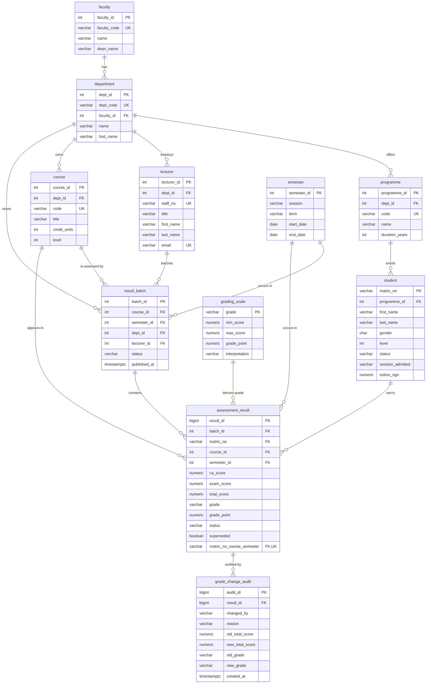

# Advanced Database Systems (MIT 8103) — CA Portfolio

**Student:** Uwakmfonabasi Ntiedo Ntah
**Student ID:** 301923611
**Institution:** Miva Open University (MIT programme)
**Cohort:** September 2026
**Term:** Advanced Database Systems (MIT 8103)
**Date:** November 2025

---

## 1. Case study — Ibom Crown University Result Processing System

### 1.1 Organisation

**Ibom Crown University (ICU)** is a fictional private university in Uyo, Akwa Ibom State, Nigeria. It runs conventional four-year undergraduate programmes organised into faculties and departments. The case study is scoped to the **Student Management and Result Processing** subsystem — the academic records core of the university — and deliberately excludes course registration with capacity limits, hostel/room/seat allocation, timetables, and fee payment, which are covered by other students' projects.

The fictional campuses referenced sit in **Uyo** (main campus, Akwa Ibom State) with affiliated outreach centres in **Eket** (Akwa Ibom), **Calabar** (Cross River State) and **Abak** (Akwa Ibom). Tuition is denominated in **Naira (₦)**. All names are Nigerian and gender-matched.

### 1.2 Users

| User | Role in the result workflow |
| --- | --- |
| **Lecturer** | Enters continuous assessment (CA) and exam scores for courses they teach; submits a result batch to the exam officer. |
| **Exam officer** (department) | Moderates the batch — checks totals, grade derivation, and obvious errors; marks results `APPROVED`. |
| **Head of Department (HoD)** | Pushes the approved batch to the faculty board. |
| **Faculty board** | Reviews and recommends the batch to Senate. |
| **Senate** | Final approval — the batch is `PUBLISHED` and becomes the official record. |
| **Student records officer** | Maintains student bio-data (programme, level, status). |
| **Student** | Reads their transcript and semester GPA; cannot edit any result. |

### 1.3 Data

The data model has 11 base tables in Third Normal Form:

`faculty`, `department`, `programme`, `lecturer`, `course`, `grading_scale`, `student`, `semester`, `result_batch`, `assessment_result`, `grade_change_audit`.

The biggest table is **`assessment_result`** (one row per student per course per semester: CA score, exam score, derived total, derived grade, derived grade point, approval status). Two computed views sit on top of it: `v_semester_summary` (GPA per student per semester) and `v_cgpa_summary` (cumulative CGPA, graduation class and academic standing per student). GPA and CGPA are never typed in — they are derived from `grade_point × credit_units` sums.

The Nigerian 5-point grading scale is used:

| Grade | Score range | Grade point | Interpretation |
| --- | --- | --- | --- |
| A | 70 – 100 | 5.0 | Excellent |
| B | 60 – 69 | 4.0 | Very Good |
| C | 50 – 59 | 3.0 | Good |
| D | 45 – 49 | 2.0 | Fair |
| E | 40 – 44 | 1.0 | Pass |
| F | 0 – 39 | 0.0 | Fail |

Graduation class and academic standing follow the conventional Nigerian scale: First Class (CGPA ≥ 4.50), Second Class Upper (≥ 3.50), Second Class Lower (≥ 2.40), Third Class (≥ 1.50), Pass (≥ 1.00), Fail/Withdrawal (< 1.00). Probation applies for two consecutive semesters with CGPA below 1.50.

### 1.4 Operations

The core operational loop is **result processing**:

1. **Capture** — lecturer enters CA and exam scores into a draft `result_batch`. The DB derives `total_score`, `grade` and `grade_point` from the `grading_scale`; they cannot be typed in.
2. **Moderate** — exam officer reviews and approves each result. The batch moves `DRAFT → PENDING → APPROVED`.
3. **Approve** — the batch flows through Department → Faculty Board → Senate. On Senate approval the batch becomes `PUBLISHED`. A trigger blocks publication if **any** result in the batch is not `APPROVED`.
4. **Lock** — once a batch is `PUBLISHED`, no result in it can change unless a `grade_change_audit` row is inserted in the **same transaction** explaining the change. This is the audit trail Senate requires.
5. **Compute** — `v_semester_summary` and `v_cgpa_summary` are recomputed from the published/approved, non-superseded result rows. Carry-overs (grade `F`) are tracked; a new "resit" result supersedes the failed one (the partial UNIQUE index `one_active_result_per_student_course_semester` enforces one active result per student per course per semester).
6. **Report** — transcripts and graduation class are produced from the views.

Supporting student-records operations (create/update student bio-data, change programme, change level, suspend/withdraw/graduate) feed the academic standing view but are not the core of this subsystem.

---

## 2. Repository structure

```
advanced-database-portfolio/
├── README.md                                (this file)
├── portfolio-1-database-design/
│   ├── 01_schema.sql                        11 tables, 3NF, 5 triggers, partial UNIQUE index, GPA views
│   ├── 02_indexes.sql                       FK + analytical indexes
│   ├── 03_seed_data.sql                     reference data + small sample
│   ├── 04_bulk_data.sql                     60,000 results via generate_series, relative dates
│   ├── 05_constraint_tests.sql              10 failing tests + 1 control, each BEGIN…ROLLBACK
│   └── README.md
├── portfolio-2-query-optimisation/
│   ├── 01_queries.sql                       8 queries (4 selective, 4 aggregate)
│   ├── 02_explain_analyze.sql               EXPLAIN ANALYZE before/after P2 indexes
│   └── README.md
├── portfolio-3-transactions-concurrency/
│   ├── 01_transactions.sql                  commit / rollback / SAVEPOINT demos
│   ├── race_demos.py                         6-part concurrency demo with two real sessions
│   └── README.md
├── portfolio-4-nosql/
│   ├── 01_setup.js                          collections with $jsonSchema
│   ├── 02_data_and_queries.js               seed + 3 aggregation pipelines
│   ├── 03_bulk_and_index_demo.js            40,000 docs, COLLSCAN vs compound index
│   └── README.md
├── portfolio-5-distributed-cloud/
│   ├── 01_partitioning.sql                  monthly RANGE partitioning of assessment_result
│   ├── cloud_design.md                      managed-DB design, sync/async, NDPA 2023, NUC notes
│   └── README.md
└── docs/
    └── REFERENCES.md
```

### How to run (Linux, GitHub Codespaces, non-root, Unix socket)

```bash
# PostgreSQL 16 — database already created; no passwords, no TCP, no sudo -u postgres
psql -d resultsys -v ON_ERROR_STOP=1 -f portfolio-1-database-design/01_schema.sql
psql -d resultsys -v ON_ERROR_STOP=1 -f portfolio-1-database-design/02_indexes.sql
psql -d resultsys -v ON_ERROR_STOP=1 -f portfolio-1-database-design/03_seed_data.sql
psql -d resultsys -v ON_ERROR_STOP=1 -f portfolio-1-database-design/04_bulk_data.sql
psql -d resultsys -v ON_ERROR_STOP=1 -f portfolio-1-database-design/05_constraint_tests.sql

psql -d resultsys -v ON_ERROR_STOP=1 -f portfolio-2-query-optimisation/01_queries.sql
psql -d resultsys -v ON_ERROR_STOP=1 -f portfolio-2-query-optimisation/02_explain_analyze.sql

psql -d resultsys -v ON_ERROR_STOP=1 -f portfolio-3-transactions-concurrency/01_transactions.sql
python3 portfolio-3-transactions-concurrency/race_demos.py

mongosh resultsys portfolio-4-nosql/01_setup.js
mongosh resultsys portfolio-4-nosql/02_data_and_queries.js
mongosh resultsys portfolio-4-nosql/03_bulk_and_index_demo.js

psql -d resultsys -v ON_ERROR_STOP=1 -f portfolio-5-distributed-cloud/01_partitioning.sql
```

The scripts you write yourself (setup.sh, runall.sh, collect_results.sh, replica setup, pg_basebackup) wrap the above; they are not part of this portfolio zip.

---

## 3. Entity-Relationship diagram (key columns only)



> The combined marker `FK, UK` on `assessment_result.matric_no_course_semester` represents the **partial UNIQUE index** `one_active_result_per_student_course_semester` on `(matric_no, course_id, semester_id) WHERE superseded = FALSE` — one non-superseded result per student per course per semester. It is not a real column.

---

## 4. AI-use note

Drafted by GLM-5.2; tested and fixed by Claude; run by the student.

## Run everything in one go (Codespaces)
After setup.sh: `bash runall.sh` runs Portfolios 1-5 in order, commits each, and writes my_results.txt.
